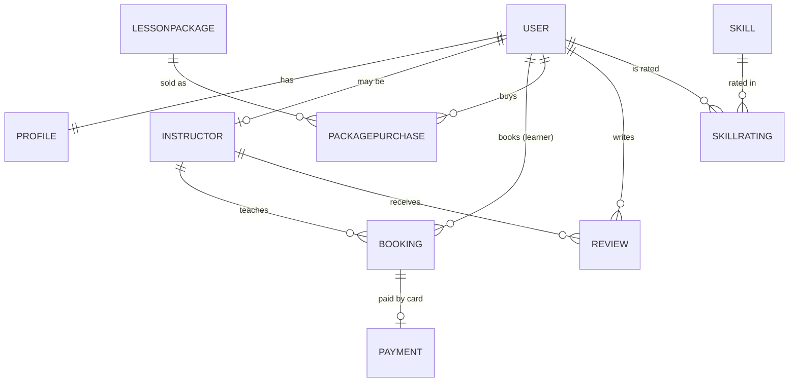

# DRX: driving lessons in East London

DRX is my personal driving-instructor website, built as a full-stack Django app. Learners can:
- check I cover their postcode
- book a lesson in a live time slot
- **buy money-saving lesson packages**
- pay online by card (Stripe) or with their package hours
- reschedule or cancel online
- watch their **test-ready score** rise as I rate their skills after each lesson

I get a diary, sign off lessons with notes, and record each learner's progress.

| | |
|---|---|
| Pay as you go | **£35 an hour** (1, 1.5 or 2-hour lessons) |
| Packages | 5 h £170 · 10 h £330 · 20 h £640 · 30 h £930 (editable in the admin) |
| Areas covered | **E1, E2, E3, E8, E9, E14, EC1, EC2, N1** |

The site is built around one instructor today. The data model still supports more instructors,
so DRX can grow into a school with branches later.


**Live site:** _add your Heroku URL here_
**Repository:** https://github.com/Md12Ali/DRX

---

## Contents

1. [Purpose and rationale](#purpose-and-rationale)
2. [User experience](#user-experience)
3. [Features](#features)
4. [Business rules](#business-rules)
5. [Data schema](#data-schema)
6. [Project structure](#project-structure)
7. [Technologies](#technologies)
8. [Testing](#testing)
9. [Deployment](#deployment)
10. [Security](#security)
11. [Credits](#credits)

---

## Purpose and rationale

I'm a trainee driving instructor working in East London. Most local instructors take bookings by phone
and WhatsApp, collect cash or bank transfers, and track progress on paper or in their head.
That causes double bookings, chasing payments, missed lessons, and learners who don't know how
close they are to being ready for the test.

DRX fixes this for three related audiences:

| Audience | Problem today | What DRX gives them |
|---|---|---|
| **Learner drivers** (17+, often students or shift workers) | Phone tag to find a slot; no idea how close they are to test standard | Live availability, instant booking, card payment, online rescheduling, a visible test-ready score |
| **Parents paying for lessons** | Unclear what they're paying for | Clear prices, receipts from Stripe, lesson notes |
| **Instructors** | Double bookings, unpaid lessons, paperwork | A diary that can't be double-booked, payment before the lesson, progress records in one place |

The progress tracker uses the five-step scale UK instructors use (Introduced, Under full
instruction, Prompted, Seldom prompted, Independent) across a 16-skill syllabus. It turns "how
many more lessons do I need?" into a number the learner can see.

---

## User experience

### User stories

**Visitor**
1. Understand what DRX offers and what lessons cost from the home page.
2. Check whether my postcode is covered before signing up.
3. Compare pay-as-you-go and package prices, and see how much each package saves.
4. See the instructor's qualification, car, working hours, reviews and free slots.

**Learner**
4. Register, log in and log out.
5. Save my phone number and pick-up address once, so I'm never asked again when booking.
6. Pick a date and see only the times that are actually free.
7. Choose a 1, 1.5 or 2-hour lesson and see the price update.
8. Pay securely by card and get clear confirmation, or a clear message if payment fails or I cancel.
8a. Buy a package of hours, see my balance, and pay for lessons with those hours.
8b. Get my hours back automatically if I cancel a lesson paid with package hours.
9. See my next lesson, upcoming lessons and past lessons.
10. Reschedule or cancel up to 24 hours before, and get a refund automatically.
11. Read my instructor's notes after each lesson.
12. See my progress in every skill and a test-ready percentage.
13. Review my instructor after a completed lesson, then edit or delete my review.
14. Delete my account and data.

**Instructor**
15. See my next 14 days of lessons in a diary.
16. Sign off lessons with notes.
17. Rate a learner's skills after a lesson.
18. Edit my public profile, prices, working days and hours.
19. Cancel a lesson (e.g. illness) and refund the learner automatically.

**Owner (admin)**
20. Add instructors, manage bookings, payments, reviews and the syllabus in the Django admin.

### Design

- **Look and feel:** "road" theme. Asphalt dark (`#171c23`) header, hero and footer. Road-marking
  amber (`#f4b400`) for calls to action and highlights. L-plate red (`#c8233a`) for warnings and
  destructive actions. Green (`#1b7343`) for success and progress. Text and button colour pairs meet
  WCAG AA contrast (amber is always paired with dark text).
- **Type:** *Archivo* (expanded, heavy) for headings, a sturdy automotive feel. *Inter* for body text.
- **Layout:** layout patterns (hero with search, stats strip, steps, bento features, reviews, FAQ,
  call to action) follow the VibeUI layout library. Booking pages use a two-column layout with a
  sticky summary panel, which stacks on mobile.
- **Wireframes:** _add images in `docs/wireframes/`_ for Home, Instructor list, Instructor profile,
  Booking form, Checkout, Learner dashboard, Progress, Instructor diary (mobile and desktop).

### Accessibility

- Semantic landmarks, one `h1` per page, skip link, visible amber focus ring.
- Every input has a label. Errors and help text are linked to fields (`aria-describedby`, `aria-invalid`).
- Time-slot buttons use `aria-pressed`. Availability and countdown updates use `aria-live`.
- The test-ready score uses a native `<progress>` element. Radio groups use `fieldset`/`legend`.
- Animations are disabled for users who prefer reduced motion.
- 44px minimum touch targets.

### UX decisions worth noting

- **Progressive enhancement:** the slot picker loads free times with JavaScript, but the date and
  time inputs still work without it. The server checks every rule again, so a booking can never
  break them.
- **Confirmation pages** (not pop-ups) for learner cancellations, account deletion and review
  deletion. One exception: the instructor "Cancel and refund" button uses a browser `confirm()`
  so instructors can act quickly from the lesson page. The action is still POST-only and CSRF-protected.
- **Never ask twice:** the pick-up address is pre-filled from the learner's details, and Stripe
  checkout is pre-filled with their email.
- **Slot hold:** an unpaid booking holds its time for 35 minutes, with a visible countdown, so two
  learners can't pay for the same slot.
- **Inline styles:** none, except the CSS variable set by JavaScript for the dashboard score ring.

---

## Features

| Area | Features |
|---|---|
| Home | Personal hero, key facts, prices and packages, **postcode checker** (works with or without JavaScript), areas covered, about me, bento features, real reviews only, FAQ |
| Prices | Pay-as-you-go prices, every package with price per hour and saving, learner's hour balance and purchase history |
| Packages | Stripe Checkout for packages, success/cancel handling, webhook; hours spent on bookings and returned on cancellation |
| Areas | Pick-up postcodes checked against E1, E2, E3, E8, E9, E14, EC1, EC2, N1 on sign-up details and every booking |
| Instructor profile | Qualification badge (trainee or ADI), facts, bio, prices, 14-day availability strip, reviews |
| Booking | Live slot picker (JSON API), 1/1.5/2-hour lessons, notes, rule checks, 35-minute payment hold |
| Payments | Stripe Checkout, success/cancel pages, webhook, automatic refunds on cancellation |
| Learner dashboard | Next lesson, test-ready ring, hours driven, upcoming and past lessons |
| Booking detail | Status, payment, lesson notes, reschedule/cancel (learner) or sign-off/cancel (instructor) |
| Progress | 16-skill syllabus, five-step levels, test-ready score, "focus next" suggestions |
| Instructor tools | 14-day diary, lessons to sign off, learner list, skill rating form, profile editor |
| Reviews | Only after a completed lesson; one per learner per instructor; full CRUD |
| Accounts | Register, log in, log out (POST), details with UK phone/postcode validation, delete account |
| Errors | Custom 403, 404 and 500 pages |

### CRUD summary

| Model | Create | Read | Update | Delete |
|---|---|---|---|---|
| Booking | Book a lesson | Dashboard, detail, diary | Reschedule; instructor sign-off | Cancel (status change and refund) |
| Review | Write a review | Instructor profile, home | Edit review | Delete review |
| Profile | Created on sign-up | My details | Edit details | Delete account |
| Instructor | Admin | Directory, profile | Instructor edits own profile | Admin |
| SkillRating | Instructor rates a skill | Progress pages | Re-rate | Set to "Not started" |
| Payment | Checkout | Booking detail, admin | Webhook, success, cancel, refund | Admin |
| LessonPackage | Data migration / admin | Prices page, home | Admin (prices, popular flag) | Admin (or deactivate) |
| PackagePurchase | Buy a package | Prices page history, admin | Webhook, success, cancel | Admin |

---

## Business rules

All rules live in one place: `drx/settings.py` (values) and `bookings/services.py` (logic).

| Rule | Value |
|---|---|
| Minimum notice | 12 hours |
| Book ahead | up to 8 weeks |
| Start times | on the hour or half hour, inside the instructor's working hours and days |
| Lesson fits | lesson must end by the instructor's finish time |
| No clashes | instructor and learner can't be double-booked (overlap check) |
| Payment hold | unpaid bookings hold the slot for 35 minutes, then expire |
| Change/cancel | learners can reschedule or cancel until 24 hours before; refund is automatic |
| Lesson length | locked once paid (cancel and rebook to change it) |
| Pick-up area | postcode district must be E1, E2, E3, E8, E9, E14, EC1, EC2 or N1 (EC1A counts as EC1, E1W as E1, N1C as N1) |
| Package hours | balance = paid package hours − hours of confirmed/completed lessons paid with hours, so cancelling returns hours automatically |
| Reviews | only after a completed lesson; one per learner per instructor |
| Ratings | only by an instructor who has a confirmed or completed lesson with that learner |
| Test-ready | at least 85% overall **and** every skill "Seldom prompted" or better |

---

## Data schema

PostgreSQL in production, SQLite locally, through Django's ORM. Seven apps, one per natural part of the domain.



### `accounts.Profile`
| Field | Type | Notes |
|---|---|---|
| user | OneToOne → User | Created by a `post_save` signal |
| phone | Char(20) | UK mobile, regex validated |
| pickup_address | Char(200) | Pre-fills bookings |
| postcode | Char(10) | UK postcode, regex validated, stored upper-case |
| transmission | Choice | manual / automatic |
| created_on | DateTime | |

### `instructors.Instructor`
| Field | Type | Notes |
|---|---|---|
| user | OneToOne → User | `related_name="instructor"` |
| slug | Slug, unique | Used in URLs |
| display_name, tagline, bio | Char / Text | Public profile |
| qualification | Choice | trainee / adi. Trainees must not advertise as ADIs |
| areas_covered | Char(200) | Comma-separated; searchable |
| teaches | Choice | manual / automatic / both |
| car, photo | Char / Image | |
| hourly_rate_pence | PositiveInteger | £10–£200, stored in pence |
| working_days | Char(7) | e.g. `"012345"` = Mon–Sat |
| day_start, day_end | Time | Working hours |
| is_accepting_pupils | Boolean | Hides booking when false |

### `instructors.Review`
| Field | Type | Notes |
|---|---|---|
| instructor | FK → Instructor | |
| learner | FK → User | |
| rating | SmallInteger 1–5 | |
| comment | Text(600) | Minimum 10 characters |
| created_on / updated_on | DateTime | |

Constraint: `one_review_per_learner` (instructor, learner).

### `bookings.Booking`
| Field | Type | Notes |
|---|---|---|
| learner | FK → User | Cascade |
| instructor | FK → Instructor | **Protect**: can't delete an instructor with lessons |
| start / end | DateTime | `end` is set from the duration on save |
| pickup_postcode | Char(10) | Must be in a covered district |
| payment_method | Choice | card / package |
| duration_minutes | Choice | 60 / 90 / 120 |
| pickup_address | Char(200) | |
| learner_notes / instructor_notes | Text | |
| price_pence | PositiveInteger | Fixed at booking time |
| status | Choice | pending, confirmed, completed, cancelled, expired |
| created_on / updated_on | DateTime | `created_on` drives the payment hold |

Constraint: `booking_ends_after_start`.

### `payments.Payment`
| Field | Type | Notes |
|---|---|---|
| booking | OneToOne → Booking | |
| stripe_session_id | Char, unique | Checkout Session |
| stripe_payment_intent | Char | Needed for refunds |
| amount_pence | PositiveInteger | |
| status | Choice | pending, paid, failed, refunded, refund_failed |
| created_on / paid_on | DateTime | |

### `packages.LessonPackage`
| Field | Type | Notes |
|---|---|---|
| slug, name, description | Slug / Char | |
| hours | SmallInteger | e.g. 10 |
| price_pence | PositiveInteger | e.g. 33000 = £330 |
| is_popular, is_active, order | Boolean / Integer | Display options |

### `packages.PackagePurchase`
| Field | Type | Notes |
|---|---|---|
| learner → User, package → LessonPackage (protect) | FK | |
| hours, price_pence | Integer | Copied at purchase so later price changes don't affect it |
| status | Choice | pending, paid, failed |
| stripe_session_id (unique), stripe_payment_intent | Char | |
| created_on / paid_on | DateTime | |

### `progress.Skill` and `progress.SkillRating`
| Skill field | Notes |
|---|---|
| name (unique), category, description, order | 16 skills loaded by data migration `0002_seed_syllabus` |

| SkillRating field | Notes |
|---|---|
| learner → User, skill → Skill | unique together (`one_rating_per_skill`) |
| level | 1 Introduced … 5 Independent |
| updated_by → User | the instructor who set it |

---

## Project structure

```
drx/            settings (all config in one place), root URLs, WSGI/ASGI
core/           home, about, postcode checker, error handlers, postcode helpers, test factories, setup_instructor command
accounts/       Profile, registration, log in/out, learner details, context processor
instructors/    Instructor, Review, directory, profiles, availability API, reviews CRUD
bookings/       Booking, booking rules (services.py), booking/reschedule/cancel, diary, sign-off
payments/       Payment, shared Stripe client, card or package-hours payment, webhook, refunds
packages/       LessonPackage, PackagePurchase, hour balance, prices page, buying packages
progress/       Skill, SkillRating, syllabus data migration, progress pages, rating form
templates/      base.html, 403/404/500, shared includes
static/         css/style.css, js/script.js, images/
```

Each app has its own models, forms, views, namespaced URLs, admin, templates, migrations and tests.

---

## Technologies

Python 3.12 · Django 5.2 · PostgreSQL · Stripe (Checkout, Webhooks, Refunds) · Pillow ·
WhiteNoise · Gunicorn · dj-database-url · HTML5 · CSS3 · vanilla JavaScript · Google Fonts
(Archivo, Inter) · Git and GitHub · Heroku

---

## Testing

### Automated tests

There are 117 Django tests across seven apps. Stripe is always mocked. Shared factories are in
`core/testing.py`.

```bash
python manage.py test
coverage run manage.py test && coverage report   # optional (pip install coverage)
```

Highlights:
- **bookings:** every rule in `services.py` (notice, window, working hours, day off, half-hour
  starts, instructor and learner clashes, rescheduling), hold expiry, permissions, reschedule
  cut-off, cancel with and without refund, instructor sign-off and cancel.
- **payments:** checkout page, redirect to Stripe, Stripe outage, missing keys, expired hold,
  success verified with Stripe, unpaid sessions not trusted, cancel page, webhook events, bad
  signature, refunds succeed or are flagged.
- **instructors:** pro-rata pricing, start-time generation, filters and search, availability API
  validation and clash removal, profile editing rules, review permissions and CRUD.
- **packages:** seeded packages, savings maths, hour balance (only paid purchases; cancelled lessons
  return hours), pay with package hours (enough / not enough), buying through Stripe, Stripe outage,
  success, cancel, webhook.
- **core:** postcode parsing (EC1A → EC1, E1W → E1, N1C → N1, E10 is not E1), every covered and
  several uncovered postcodes, the home-page checker and its JSON API.
- **progress:** syllabus data migration, score maths, test-ready rule, rating permissions and saving.
- **accounts / core:** sign-up, unique email, UK phone and postcode validation, anonymous-only
  pages, POST-only logout, account deletion, home, about and 404 pages.

### Manual testing

| # | Test | Expected | Result |
|---|---|---|---|
| 1 | Register, then add phone and address | Logged in; details saved; message shown | |
| 1a | Enter postcode IG3 8XX in details | "Pick-ups are only available in E1, E2…" | |
| 1b | Check "EC1A 1BB" on home page | "Yes! … is in EC1" without page reload | |
| 1c | Buy the 10-hour package (card 4242…) | "10 hours added"; balance shows 10 | |
| 1d | Book 1.5 h, choose "Use 1.5 hours from my package" | Booking confirmed; balance 8.5 | |
| 1e | Cancel that lesson | "1.5 hours went back into your package" | |
| 2 | Click "Prices" | Pay-as-you-go and 4 packages with savings | |
| 3 | Open an instructor, click a green day | Booking form opens with that date | |
| 4 | Change lesson length | Free times reload for the new length | |
| 5 | Pick a slot and continue | Checkout shows summary, total and countdown | |
| 6 | Pay with `4242 4242 4242 4242` | "You're booked in!"; booking confirmed | |
| 7 | Pay with `4000 0000 0000 0002` | Stripe shows decline; booking stays unpaid | |
| 8 | Click back on Stripe checkout | "Payment cancelled. You have not been charged." | |
| 9 | Leave a booking unpaid for 35 min | Slot released; booking shows "Expired" | |
| 10 | Two browsers book the same slot | Second sees "that time has just been booked" | |
| 11 | Reschedule a lesson more than 24h away | Moved; same price | |
| 12 | Try to reschedule inside 24h | Blocked with "please call your instructor" | |
| 13 | Cancel a paid lesson | Refund in Stripe dashboard; message shown | |
| 14 | Instructor signs off a lesson | Status completed; redirected to rating form | |
| 15 | Instructor rates skills | Learner's score and bars update | |
| 16 | Learner writes, edits, deletes a review | Each step works; only after a completed lesson | |
| 17 | Learner opens `/bookings/diary/` | 403 page | |
| 18 | Learner opens another learner's booking URL | 403 page | |
| 19 | Visit `/nope/` | Custom 404 with links home | |
| 20 | Delete account | Logged out; data removed | |
| 21 | 360px / 768px / 1280px | Layout adapts; menu collapses | |
| 22 | Keyboard only | Skip link, focus ring, slot buttons and menu all usable | |

### Validators

Record results with screenshots in `docs/testing/`:
[W3C HTML](https://validator.w3.org/) (paste "View source" from the live site) ·
[Jigsaw CSS](https://jigsaw.w3.org/css-validator/) · [JSHint](https://jshint.com/) (`esversion: 11`) ·
`flake8` (config in `setup.cfg`: PEP 8 with Django's 119-character line length) · Lighthouse · WAVE.

### Known limitations

- Uploaded instructor photos are stored on the server's disk. On Heroku the disk resets on each
  deploy, so use Cloudinary or S3 for photos in production.
- Times assume the UK time zone (`Europe/London`).

---

## Deployment

### Local

```bash
git clone https://github.com/Md12Ali/DRX.git && cd DRX
python -m venv .venv && source .venv/bin/activate      # Windows: .venv\Scripts\activate
pip install -r requirements.txt
cp env_example.py env.py        # then fill in your own keys
python manage.py migrate        # also loads the 16-skill syllabus
python manage.py createsuperuser
python manage.py setup_instructor <your-username> --name "Mohammed Ali"
python manage.py runserver
```

`setup_instructor` turns your account into the site's instructor at £35/hour, covering the postcodes
in settings, shown as a **trainee**. Add your photo, bio, car and hours under *Edit profile*. When
you qualify, change *Qualification* to ADI (or re-run with `--adi`).

**Change prices or areas:** the hourly rate and covered postcodes are in `drx/settings.py`
(`STANDARD_HOURLY_RATE_PENCE`, `COVERED_POSTCODE_DISTRICTS`). Package prices are in the admin under
*Lesson packages*.

### Stripe

1. Create a Stripe account and stay in **Test mode**. Put the publishable and secret keys in
   `STRIPE_PUBLIC_KEY` and `STRIPE_SECRET_KEY`.
2. Local webhooks: `stripe listen --forward-to localhost:8000/payments/webhook/`, then copy the
   `whsec_…` value into `STRIPE_WEBHOOK_SECRET`.
3. Production webhooks: Developers → Webhooks → add `https://<app>.herokuapp.com/payments/webhook/`.
   Select `checkout.session.completed`, `checkout.session.expired`,
   `checkout.session.async_payment_succeeded` and `checkout.session.async_payment_failed`.

### Heroku with PostgreSQL

1. Create the app, then add Heroku Postgres (or another Postgres URL) as `DATABASE_URL`.
2. Config vars: `SECRET_KEY`, `DATABASE_URL`, `ALLOWED_HOSTS=<app>.herokuapp.com`,
   `CSRF_TRUSTED_ORIGINS=https://<app>.herokuapp.com`, `STRIPE_PUBLIC_KEY`, `STRIPE_SECRET_KEY`,
   `STRIPE_WEBHOOK_SECRET`, `SECURE_SSL_REDIRECT=True`. **Do not set `DEBUG`.** It defaults to off.
3. Connect the GitHub repo and deploy the `main` branch. The `Procfile` runs migrations in the
   release phase and starts Gunicorn. WhiteNoise serves static files after `collectstatic`.
4. Run `python manage.py createsuperuser` from the Heroku console and add your instructor profile.
5. Repeat the manual tests on the live site and check it matches the local version.

---

## Security

- No secrets in Git. Everything comes from environment variables, and `env.py` is git-ignored.
  The app refuses to start in production without `SECRET_KEY`.
- `DEBUG` is off by default. Secure cookies and an optional SSL redirect apply in production.
- CSRF on every form. Log out, cancel, sign-off and checkout use POST.
- Every booking, review and rating is checked on the server: learners only see their own bookings;
  instructors only see theirs; only staff reach `/admin/`.
- Payments are verified with Stripe on the server, never trusted from the URL. Webhooks are
  signature-checked. Card details never touch DRX.

---

## Credits

- Django, Stripe and WhiteNoise documentation.
- Syllabus and five-step progress scale based on common UK driver-training practice (DVSA).
- Layout patterns inspired by the VibeUI layout library. Fonts from Google Fonts.
- All content and code written for this project. Reviews on DRX only ever come from real learners
  who have completed a lesson.
- Postcode district names for the covered areas are approximate and for guidance.
